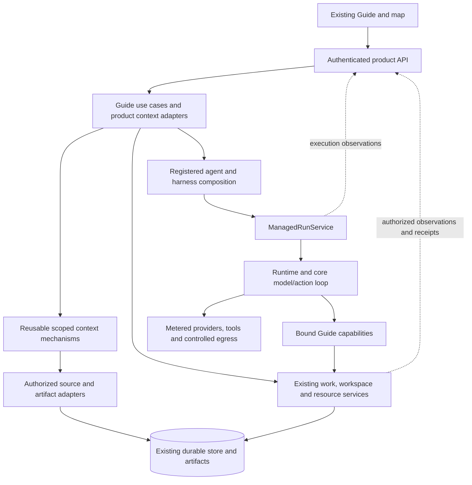

# Make the Guide more useful throughout the work

Date: October 13, 2026. Status: **in progress; initial GDE-001/002 slice implemented, product acceptance open**.
Source baseline: `55b77acf`. Parent: [First use to useful team work](plan.md).

## Product objective

**Help a person turn uncertain thoughts into worthwhile outcomes, carry more work
at once, and stay in control with less explaining, navigating and supervising.**

The Guide is the person's ongoing point of contact with Tetonic. It should be
useful while they are thinking, while agents are working, and when results arrive.
The improvement is how well that relationship works: the quality of help offered,
the timing of that help, the actions available, and the effort required to use it.

### October 13 implementation increment

The Guide can retain useful decisions and corrections during exploration without
writing a team proposal. The existing `work_plan` tool gained a `remember`
operation; existing versioned briefs remain the storage owner. Revision and
started-work checks are transactional. A human edit wins over a stale Guide save;
notes cannot authorize or dispatch work. No hardcoded intent router was added.

The existing conversation shows a quiet, collapsed **Our working understanding**
control only when notes exist. It expands in place and links to the existing
editor; returning preserves the conversational draft. Ordinary answers no longer
automatically prompt the person to plan work. Actual proposals and execution
problems retain their existing presentation. Guide instructions emphasize useful
answers, tradeoffs, proportionate clarification and naturally changing intent.

Automated coverage exercises corrected notes across turns and reopening, exact
retries, stale human edits, foreign conversation rejection, completed-turn
rejection and notes-to-proposal in one reply through OpenAI/Anthropic/Google test
transports. Browser inspection used an isolated fixture, not the owner's data.
These establish plumbing and interaction behavior; they do not prove live-model
usefulness or complete GDE-001/002. Long conversation limits, richer work reads,
cross-effort continuity and the varied-domain owner journey remain open.

Verification on October 13: app library 214 passed / 5 ignored; memory library
195 passed; web 318 passed plus 13 architecture/appearance checks; production web
build passed; engine `verify package` passed formatting, workspace/all-target
Clippy, architecture and static quality. The final Guide-focused app rerun passed
9 tests. No paid provider calls, live workspace writes or engine restart were
performed. The browser check used fixture content to assess layout only.

Keep the current map, expanding Guide conversation, inspector and visual identity.
Refine the behavior and presentation inside those surfaces. Users should not have
to choose a conversation mode, learn an orchestration vocabulary, or turn every
question into a project.

The previous version made context, persistence and capability plumbing the delivery
milestones. This revision replaces those seven proposed tickets with six product
outcomes. GDE-001–006 below have revised meanings; the old GDE-007 validation ticket
becomes the acceptance work inside every outcome. Nothing from that rejected
version is claimed complete. Engineering ownership remains a delivery constraint.

## The improvements a person should experience

| Priority | Ticket | Improvement | What changes in the existing Guide |
|---|---|---|---|
| First | [GDE-001](#gde-001) | Get useful help without figuring out how to ask | Responses meet the actual need; small questions stay small, uncertain ideas get constructive help, missing setup is handled when relevant |
| First | [GDE-002](#gde-002) | Think through a problem and arrive at a clearer direction | The Guide helps compare options, surfaces useful questions and preserves decisions without forcing a plan |
| Next | [GDE-003](#gde-003) | Hand over work without becoming the project manager | The Guide turns agreed intent into an understandable, feasible handoff using available agents and capabilities |
| Then | [GDE-004](#gde-004) | Keep several efforts moving without checking every agent | Answers explain meaningful progress, consequences, decisions and what deserves attention |
| Then | [GDE-005](#gde-005) | Change course or recover without starting over | Corrections, blockers and stops stay attached to the relevant work with a clear account of the effect |
| Then | [GDE-006](#gde-006) | Get useful outcomes and make the next decision easily | The Guide presents the actual result, supports scrutiny and carries a targeted follow-up forward |

These are acceptance dimensions, not six hardcoded request categories or a
sequential UI workflow. A single turn can serve several of them. Conversation
continuity, truthful status and permission boundaries apply across all six.

## Intelligent interaction as a product requirement

The person expresses intent naturally; the Guide uses context, evidence and
available capabilities to decide how to help. Do not require the person to select
a predefined behavior, use particular wording or follow a scripted conversation.
The six outcomes above evaluate usefulness; they must not become a six-way router,
six buttons or six mandatory stages hidden behind conversational wording.

- Adapt the depth, sequence and combination of assistance as the conversation
  develops. Mixed intentions, detours, corrections and unfamiliar requests are
  normal inputs, not exceptions that must be forced into a category.
- Use small, well-defined capabilities that the Guide can combine. Examples and
  evaluation scenarios must not become hardcoded domain workflows or canned
  response branches. Deterministic parsing, validation and protocol handling
  remain appropriate engineering mechanisms.
- Show a control when it helps the person make a concrete choice, grant approval,
  inspect evidence or perform a precise action. Suggested choices are shortcuts;
  they should not replace the ability to express a different intent naturally.
- Ground initiative in the person's situation and actual system capabilities.
  Ask when consequential ambiguity remains; do not confuse an intelligent feel
  with guessing authority, pretending to know or silently starting extra work.
- Keep permissions, budgets, execution ownership and action confirmation reliable
  and enforced. Flexible conversational behavior operates within these boundaries.

Every product slice must also be tried with unfamiliar phrasing, a different
domain and a mid-conversation change of direction. Success means useful progress
without teaching the person special commands, requiring them to classify their
request or fitting their intent to a canned path. Preserve the current design;
this requirement does not add generative layouts or a new interaction surface.

## GDE-001

### Make the next exchange useful

**Person's need:** "I can say what is on my mind and the Guide helps me move
forward. I do not need to know how Tetonic works to get something useful."

**Change the product**
- Improve the first and subsequent responses to ambiguous or loosely formed
  requests. Offer an interpretation, a useful observation or a manageable next
  question rather than a generic capability pitch or a premature work plan.
- Answer straightforward questions directly. Use relevant system capabilities
  when an answer depends on real work, available resources or saved decisions.
  Do not claim to have checked something without doing so.
- Match depth to the interaction: concise when the person wants a quick answer;
  exploratory when they are developing a thought. The person can change that
  preference naturally in the conversation.
- Ask only for missing information that materially changes the next useful step.
  Do not repeatedly request already supplied context or impose an intake form.
- When the requested help needs an unavailable capability, explain the specific
  gap and offer a useful next choice. Keep general discussion available while
  setup is unresolved. Avoid dead-end refusals and generic trips to settings.

**Presentation:** stay in the existing conversation. Lead with the answer or
useful next thought; offer relevant actions beside that response. Keep inventory,
technical limits and configuration secondary. No always-visible suggestion grid,
new mode selector or mandatory plan preview.

**Demonstrate it:** use a short fact question, a vague noncoding idea, a question
about active work, and a request requiring a missing connection. The person gets
a relevant answer or clear next choice without an unwanted work item, repeated
setup questions or unnecessary navigation. Change wording and domain to ensure
the behavior is not scripted to examples.

**Supporting work:** improve Guide response guidance and access to the specific
authorized reads these examples need. Trace the existing path as part of fixing
it; a separate architecture audit is not the first product milestone.

**Parents:** EXP-001/003/007; JRN-02. Relative effort: M, depending on missing reads.

## GDE-002

### Help the person develop a direction worth pursuing

**Person's need:** "I can work through an idea here, understand my options, and
see my thinking become clearer without being pushed into execution."

**Change the product**
- Make the Guide an active thinking partner: compare approaches against the
  person's concerns, explain tradeoffs, notice conflicting requirements and
  identify which uncertainty is worth resolving next.
- Offer a recommendation when there is enough basis for one, explaining its
  assumptions. Avoid merely rephrasing the user or endlessly asking questions.
- At useful moments, reflect a concise working understanding: what the person
  wants, what they have decided and what remains open. Show only what helps now.
  Let the person correct it in ordinary language.
- Keep alternatives available until rejected or chosen. "Maybe" stays tentative;
  "we decided against that" stays settled unless the person revisits it.
- Suggest a bounded investigation when evidence is needed. Explain what it would
  help decide, and seek the applicable work authorization before dispatch.
- Allow a detour into another effort and a return to the original idea without
  another explanation. Preserve relevant decisions across long discussions and
  reloads; do not publish private exploration to a team by default.

**Presentation:** use readable conversation and the existing brief presentation
when helpful. A concise comparison or summary can appear inline at a decision
point; it need not become a permanent panel or another document to maintain.
Accept corrections in the composer rather than requiring edits to individual
task fields. Preserve the person's place and draft through detours.

**Demonstrate it:** explore two approaches, reject one, revise a constraint, ask
about other work, reload and return. The Guide gives a useful comparison, keeps
the correction, does not revive the rejected approach, and helps the person
choose a next step without creating a plan merely because they brainstormed.

**Supporting work:** adapt existing briefs, scoped recall and context packing to
retain source-linked decisions and corrections. Resolve raw-history limits only
as needed to deliver this continuity. No inferred global personality profile.

**Parents:** EXP-001/005; JRN-02/06. Relative effort: L due to long-conversation behavior.

## GDE-003

### Make delegation feel like a natural continuation

**Person's need:** "Once I know enough, I can hand over the work and trust that
the team received what I meant. I should not have to assemble every assignment."

**Change the product**
- Recognize when the person is asking to act versus still considering an option.
  Offer a clear handoff when appropriate without making them hunt for it.
- Carry forward the agreed outcome, relevant context, constraints and definition
  of a useful result. Do not ask the person to repeat decisions already made.
- Check the actual team, capabilities and limits before recommending how to
  proceed. Explain meaningful tradeoffs, such as a smaller first investigation
  when a wider effort cannot fit the available resources.
- Choose a proportionate approach. A small request should not acquire a large
  team or elaborate plan. Larger work can use independent agents in parallel,
  with dependencies only where contributions are actually needed.
- Present one current proposal. Conversational corrections update that proposal
  and highlight the consequential change, without competing visible copies.
- Make missing access or configuration resolvable in context. Return from the
  existing editor to the same proposal and draft.
- After the existing explicit start action succeeds, make it obvious what is now
  underway and where to follow it on the map. Distinguish actual start from an
  uncertain response or a readiness failure.

**Presentation:** a compact handoff in the existing Guide/review surface: intended
result, proposed contributors, material boundaries and one clear next action.
Detailed assignments remain inspectable. Preserve the current review/start
authority; reduce navigation and repetition around it.

**Demonstrate it:** shape a real request, make two conversational revisions, fix a
setup gap and start the intended version once. Two agents make independent useful
contributions where the task warrants it. The person can explain what they
authorized and see it begin without manually writing assignments. A small request
has a correspondingly small interaction.

**Supporting work:** reuse current proposals, readiness, grants, start receipts
and managed parallel dispatch. Improve the Guide's use of these capabilities.
No new scheduler or automatic permission escalation.

**Parents:** EXP-002/004/006/009; JRN-03. Relative effort: L; useful execution is a dependency.

## GDE-004

### Help the person oversee more work with less attention

**Person's need:** "I can pursue something new while the Guide helps me understand
what is happening elsewhere and what, if anything, needs me."

**Change the product**
- Answer natural questions such as what changed, what is stuck, why a result is
  late, which agents are available and what remains within budget using current
  authorized records.
- Organize answers around outcomes and consequences. Explain "the recommendation
  is waiting for source verification" rather than enumerating every task event.
- Prioritize an answer according to the person's question and expressed priorities.
  Separate an item needing a human decision from work continuing independently.
  Do not reorder or stop work simply because it receives less conversational attention.
- Explain uncertainty honestly: distinguish an agent working, a dependency wait,
  missing access, a failed attempt and a result ready to inspect. Never invent
  percentages, ETA or resource availability.
- Offer grounded opportunities to reduce effort, such as reusing a relevant
  existing result. Explain the benefit; do not start extra work or merge efforts
  without the necessary direction.
- Link an answer to the relevant work, evidence or decision on the existing map
  and inspector. Preserve the conversation when the person looks closer.

**Presentation:** concise summaries with the most relevant next action and
optional detail. Use current Needs you and activity surfaces for actual exceptions.
No recurring unsolicited chat narration, new monitoring dashboard, or requirement
to read the Blackboard to understand ordinary progress.

**Demonstrate it:** three efforts are in different states, one awaiting a human
answer. The person asks for an overview, investigates one issue and returns to
their discussion. They correctly identify what needs them and what can continue
without opening every assignment or reading every agent message. Test with real
or explicitly labeled fixture records, not hand-polished filler as proof.

**Supporting work:** scoped status/resource reads and compact, source-linked
projections. Preserve observation times and refresh facts when answering current
status questions. No workspace-wide context dump or background supervisor model.

**Parents:** EXP-005/007; OCT-205; JRN-04/06. Relative effort: M with existing read coverage.

## GDE-005

### Make changes and problems easy to handle

**Person's need:** "When my priorities change or something goes wrong, I can deal
with it where I already am without losing the useful work."

**Change the product**
- Accept a correction in the conversation and relate it to the intended effort.
  Show the interpretation when it matters; clarify materially ambiguous targets.
- Explain the effect in terms of the person's outcome: what changes, what keeps
  running, what can be reused and what needs a new decision.
- Support the existing safe paths for changing upcoming work, stopping execution
  and continuing from previous results. Do not imply unsupported live edits are
  available. Distinguish dropping an idea from stopping its active work.
- Bring a blocker back as a decision the person can make: why it matters, realistic
  options, a recommendation where justified and the affected work. Avoid both
  technical error dumps and repeated "what would you like to do?" loops.
- Carry a resolved answer or setup change back to the relevant work. Confirm the
  actual outcome and disclose when the change has not reached a running agent.
- Keep drafts and the current discussion through failed calls, disconnection and
  retry. A lost response must not silently produce a second action or launch.

**Presentation:** specific inline questions and actions, using existing review,
human controls and settings. Offer relevant evidence on demand. A short activity
cue corresponds to a real operation; failures end the cue and offer a next step.
Keep stop controls reachable and show stopping until it is confirmed.

**Demonstrate it:** change one part of an effort, leave another running, respond
to a blocker, then encounter a lost response and reconnect. The person can tell
what changed, what did not and what remains unresolved without rebuilding a plan
or losing their draft. Stopping is honest about already completed effects.

**Supporting work:** current amendments, human controls, managed lifecycle,
idempotent receipts and frontend event handling. Preserve permission checks,
budget holds and uncertain outcomes. Selection changes cannot retarget an action.

**Parents:** EXP-004/005/007; JRN-03/05. Relative effort: L across existing control paths.

## GDE-006

### Make results useful and easy to build on

**Person's need:** "I get something I can use, understand whether it met my intent,
and can improve it without starting the explanation again."

**Change the product**
- Bring back the actual deliverable or answer, where to use it, and how it meets
  the agreed objective. Distinguish finished assignments from a satisfactory
  outcome; identify unmet requirements plainly.
- Explain what was checked and what remains uncertain. Make underlying evidence,
  relevant contributions and artifacts available without leading with transcripts.
- Allow questions about the result: why an approach was taken, what evidence
  supports it and which alternatives were considered. Do not invent retrospective
  reasoning when the records do not establish it.
- Attach a correction to the result being discussed and preserve the parts the
  person wants to keep. Prepare bounded follow-up work when needed and retain its
  relationship to the original effort.
- On return, help the person recover their place: useful results, decisions waiting
  for them and the next meaningful choice. Keep this scoped to the conversation
  or requested overview, not a compulsory return modal.
- Suggest a next step only when it serves the person's intent. A useful completed
  answer should not automatically create more work.

**Presentation:** concise result summary and direct artifact/evidence links through
existing Guide and inspector surfaces. Follow-up begins from the result in the
same interaction. Prior outputs remain inspectable.

**Demonstrate it:** inspect a real result, question one claim, request a targeted
revision and return after it finishes. The person can use the output, find its
supporting evidence and verify that the intended portion changed without copying
the entire context back into chat.

**Supporting work:** accepted outcome/artifact references, existing continuation
lineage and scoped recall. No second result ledger or assumed automatic replay
of interrupted effects.

**Parents:** EXP-005/007/009; JRN-06. Relative effort: M; actual useful results required.

## How to deliver and judge the work

Start with GDE-001 and GDE-002 as one usable improvement: a person brings an
uncertain idea, receives constructive help, compares options, corrects the
direction, briefly checks other work, and returns to the correct understanding.
Include the technical changes and UI behavior needed for that slice. A new context
component or a better prompt alone does not complete the product outcome.

Follow with GDE-003 so the improved thinking experience leads to real useful team
work. Then refine GDE-004/005 around overseeing and changing concurrent work, and
GDE-006 around using and improving the results. Take the minimum recovery and
result behavior needed into earlier slices; do not ship a knowingly broken
handoff while waiting for its ticket number.

For every slice:
1. Walk its current behavior and record the actual friction.
2. Specify the response/action/placement change in the existing Guide.
3. Trace and adapt the existing engine owners necessary to make it real.
4. Demonstrate the improved journey with unfamiliar wording and another domain.
5. Record results, remaining limitations and the next smallest useful increment.

Compare the person's experience before and after: useful progress, repeated
explanations, unnecessary clarifications, navigation detours, incorrect target
interpretations and whether the person understands the next action. Technical
checks establish permission, persistence and execution correctness; actual owner
walkthroughs establish perceived usefulness and clarity. Do not substitute exact
model wording, attractive fixture content or component tests for product proof.

Zero unauthorized changes, duplicate starts, private-context leaks and false
success claims are required in the exercised cases. Measure response latency and
model/context usage so additional assistance does not become slow or wasteful.
Test small questions as seriously as the larger delegation journey.

## Scope and existing commitments

This is a revised proposal within the [existing corrective sprint](plan.md), not
an additional calendar sprint or six new interface modes. It refines the Guide
portions of the [product journey plan](product-continuity-2026-10-13.md); wider
EXP/OCT obligations remain open. The failed
[large-project proof](project-width-proof-2026-10-13.md) remains an execution
dependency, not something that conversational improvements can declare solved.

October 25 remains the target and October 18 the existing freeze. Relative effort
is uncertainty, not a promise that all refinements fit. Estimate each product
slice against the remaining window and surface scope/date conflicts explicitly.
Do not turn planning approval into permission for unbounded paid qualification.

Retain current design. Autonomous recurrence, new agent families, reinforcement
learning, inferred personal profiling, arbitrary live plan rewriting, marketplace
integration, distributed execution and generative layouts are not additions here.
Previously required work remains tracked with its existing owner.

## Engineering support for the product outcomes

The following is a supporting design constraint and reuse inventory, not the
sprint's delivery sequence. Architecture work earns its place by enabling one of
the product outcomes above.

## Architecture contract

Follow [ownership](../../../../architecture/ownership.md),
[execution boundaries](../../../../architecture/execution-boundaries.md),
[durable state](../../../../architecture/durable-state-and-contracts.md), and
[frontend boundaries](../../../../architecture/frontend-boundaries.md).
Each implementation change must identify its behavioral owner, authoritative
records, existing call path, and regression evidence.

| Concern | Owner and integration rule |
|---|---|
| Conversation purpose, product relevance and choosing which use case to expose | A cohesive Guide module behind the existing `tetonic-app` work-service boundary. App code composes authorized services and shapes product inputs; it must not become the storage engine, generic context compiler or execution supervisor. Module extraction is allowed when justified by the actual call graph. |
| Reusable context selection, deduplication, bounded packing and evidence provenance | `tetonic-context`, with authorized source adapters bound by application/context services. Inspect its coding-specific contracts first; extract a minimal general mechanism while keeping the coding adapter intact. No dependency from context into app or web. |
| Source history, brief/decision revisions, visibility and operation receipts | The matching `tetonic-memory` context/control/execution records through existing scoped services. Reuse current lineage and briefs first. Add a record only when a missing invariant needs it, with migration and retention semantics. Summaries remain derived data. |
| Model/action loop, streaming protocol and context-window mechanics | `tetonic-core` and `tetonic-runtime`, only for general behavior. No Guide-specific product routing, view selection or work-plan rules in the generic loop. |
| Admission, attempt ownership, cancellation, recovery and accepted outcomes | Existing `tetonic-run` managed services. Guide turns and delegated work use registered assembly and the same lifecycle. No new supervisor, retry daemon or result authority. |
| Capability access, human approvals, budgets, tools and inference | Existing resource authorization, policy/action broker, usage ledger, tools, inference and egress owners. Guide-only advertisements do not substitute for authorization. Model choice must not bypass these owners. |
| UI contracts, activity and presentation | Local API adapters, `web/src/engine` contracts/client/projections and existing Guide components. UI selection is a hint; browser state and model prose cannot establish authority or completion. |
| Shared types | Existing domain contracts only for genuinely shared engine concepts; local DTOs remain with their owner. No grab-bag `GuideState` or generic command bus that hides all dependencies. |

The retained `tetonic-orchestrator` library has coding/session strategies. Its
name is not justification to move the Guide or product scheduler there. Do not
create a new crate merely to relocate a large application file. A new package or
service requires a concrete dependency/ownership justification and migration path.

This is the proposed responsibility arrangement, not a claim that all adapters
exist today. It introduces no new deployment topology. Authority is checked on
the actual operation, including after retrieval and before effects where required
by the existing owner; a context snapshot is never a grant.

## Current foundations and concrete gaps

| Source | What exists | Refinement needed |
|---|---|---|
| [Guide input](../../../../../engine/litho/tetonic-app/src/work/director.rs) and [bounded overview](../../../../../engine/litho/tetonic-app/src/work/director/context_budget.rs) | Scoped engine observations, current proposal, inventory and limits; automatic overview bounded to 16,000 bytes with partial markers | Relevant retrieval with explicit source, freshness and omissions as conversations and work grow |
| [Conversation input](../../../../../engine/litho/tetonic-app/src/work/conversations.rs) | Server-read history, lineage checks and saved brief; assembled input capped at 12,000 bytes and lineage at 64 turns | Continue useful discussion beyond raw-history capacity without losing corrections or forcing a new thought |
| [Guide capability](../../../../../engine/litho/tetonic-app/src/resources/work_director.rs) | Resources, work and proposal inspection; bounded proposal repair; explicit owner start | Small, well-defined operations for continuity and contextual assistance, with consistent receipts |
| [Scoped context binding](../../../../../engine/litho/tetonic-app/src/resources/context_compiler.rs) and [context interfaces](../../../../../engine/strata/tetonic-context/src/interfaces.rs) | Current-access checks and reusable context pipeline, but source interfaces are heavily repository-oriented | Reuse applicable retrieval/budgeting mechanics without requiring a repository or inventing a fake workspace for ordinary product context |
| [Work service](../../../../../engine/litho/tetonic-app/src/work/mod.rs), [controller](../../../../../engine/litho/tetonic-app/src/team_work_controller.rs) and managed execution | Existing use cases, parallel dependency scheduling, admitted attempts and durable outcomes | Integrate the Guide with these owners; do not replace their authority |
| [LiveShaping](../../../../../web/src/components/team-work/LiveShaping.tsx), Guide activity and existing projections | Connected conversation, saved drafts, review and activity presentation | Consistent target context, retained place and truthful action/failure feedback |

The two byte limits above serve different paths; neither is a provider token
budget. Simply increasing them is not the continuity solution. Existing behavior
is evidence of reusable foundations, not proof that the new journeys pass.

## Implementation review requirements

- Keep each change with its behavioral owner. Application code owns Guide product
  policy/composition; reusable context, storage, action enforcement and managed
  lifecycle retain their existing engine owners.
- Reuse registered harness assembly, current tool/MCP grants, scoped context and
  authoritative work records. Do not introduce fixed conversational categories,
  another Guide loop, another scheduler or a parallel history/result authority.
- Extend generic mechanisms only where the product slice demonstrates a need.
  Repository-oriented context interfaces must not force Git/files into ordinary
  conversations. Do not prebuild a universal framework or merely relocate bloat.
- Preserve source-linked decisions and current access checks. Summaries and
  navigation focus are not permission; suggestions are not execution approval.
- Keep APIs, deep links and saved conversations compatible or provide an explicit
  migration. New persistence has revision/conflict/retention rules.
- Run focused owner tests and required repository quality gates with implementation.
  Include stale responses, duplicate delivery, revocation, restart and partial
  failure where the slice crosses those boundaries.
- Update as-built architecture only when the code changes. Delivery notes record
  what was reused, adapted or added and the actual user journey demonstrated.
